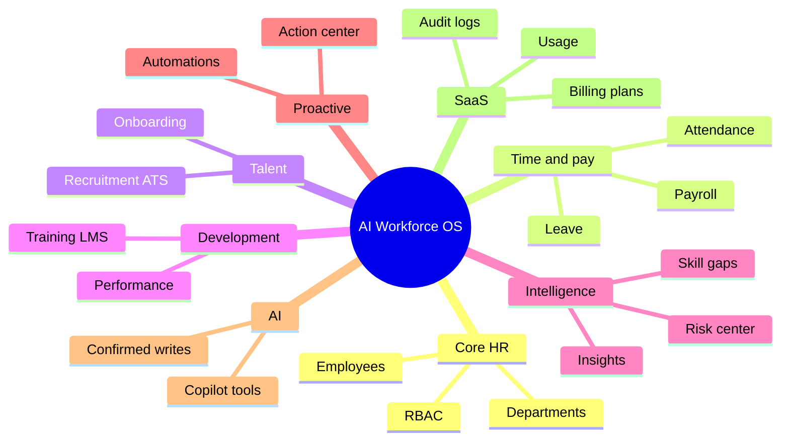
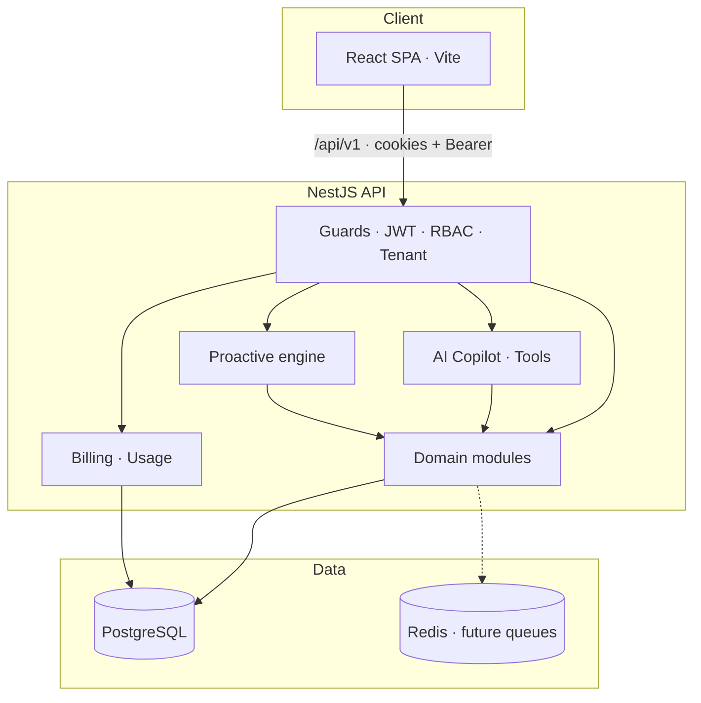
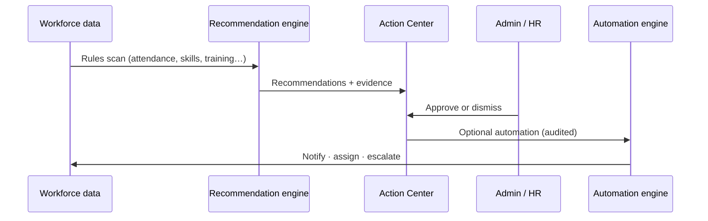
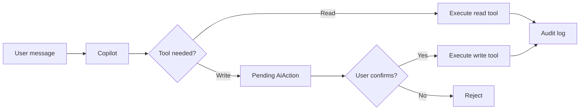

# AI Workforce Operating System


[](https://github.com/Ahad-Khan9076/ai-workforce-operating-system)


Multi-tenant B2B HR SaaS: core workforce operations, **workforce intelligence**, **proactive recommendations**, and a **tool-grounded AI copilot** — in one production-style monorepo.

**Repository:** [github.com/Ahad-Khan9076/ai-workforce-operating-system](https://github.com/Ahad-Khan9076/ai-workforce-operating-system)

---

## Table of contents

- [At a glance](#at-a-glance)
- [Architecture](#architecture)
- [Intelligence loop](#intelligence-loop)
- [AI copilot flow](#ai-copilot-flow)
- [Quick start](#quick-start)
- [Demo account](#demo-account)
- [Documentation](#documentation)
- [Quality checks](#quality-checks)
- [License](#license)

---

## At a glance



| Area | What you get |
| --- | --- |
| **Core HR** | Orgs, RBAC, employees, departments, documents, skills |
| **Time & pay** | Shifts, attendance, leave, payroll engine, payslips |
| **Talent** | Jobs, candidates, pipeline, hire → onboarding |
| **People development** | LMS, performance cycles, goals, reviews |
| **Intelligence** | Gaps, talent match, risk rules, role-aware insights |
| **Proactive** | Recommendations, action center, automations, notifications |
| **AI copilot** | HR / manager / employee modes; audited tools + confirm-before-write |
| **SaaS** | Plans, subscriptions, usage, invoices, settings, central audit |

Tenant scope comes from the **JWT**, not client-supplied `organizationId`. Permissions run in API guards and **again on every copilot tool**.

---

## Architecture



```text
hr_project/
├── backend/          NestJS · Prisma · migrations · tests
├── frontend/         React 19 · TanStack Query · shadcn/ui
├── docs/             Architecture · deploy · security · API · UI
├── docker-compose.yml          Postgres + Redis (dev)
└── docker-compose.prod.yml     Full stack (prod)
```

---

## Intelligence loop

From signal to action — without bypassing humans for risky steps:



**UI:** `/intelligence/action-center` · `/intelligence/insights` · `/intelligence/risk`

---

## AI copilot flow

The model never touches the database directly — only **approved tools** behind RBAC:



**UI:** `/intelligence/copilot` · streaming chat · confirmation cards for writes

---

## Quick start

### Prerequisites

- Node.js 20+
- Docker **or** embedded Postgres (no Docker)

### 1. Database

**Docker (recommended):**

```bash
docker compose up -d
```

**No Docker:**

```bash
cd backend && npm run db:local
```

Keep that terminal open (embedded PostgreSQL on `localhost:5432`).

### 2. Backend

```bash
cd backend
cp .env.example .env
npm install
npm run db:generate
npm run db:migrate
npm run db:seed
npm run start:dev
```

- API: `http://localhost:3000/api/v1`
- Health: `GET /api/v1/health`

### 3. Frontend

```bash
cd frontend
cp .env.example .env
npm install
npm run dev
```

- App: `http://localhost:5173` (Vite proxies `/api` to the backend)

**502 Bad Gateway?** Start PostgreSQL and the backend. Verify: `curl http://localhost:3000/api/v1/health`

### Optional: OpenAI copilot

```bash
# backend/.env
OPENAI_API_KEY=sk-...
AI_PROVIDER=auto
```

---

## Demo account

After `npm run db:seed` (development only):

| Field | Value |
| --- | --- |
| Email | `demo@hrworkforce.local` |
| Password | `DemoOwner1` |
| Organization | Demo Workforce Co |
| Role | OWNER (full access) |

Override with `DEMO_USER_EMAIL` / `DEMO_USER_PASSWORD` in `backend/.env`. Set `SEED_DEMO=false` to skip.

The same seed loads a **full demo dataset** for org `demo-workforce`: ~13 employees across Engineering, HR, and Sales; pending and approved leave; attendance (including a pending correction); September payroll in review; open jobs with candidates; training enrollments; performance goals; skills gaps; workforce risks and insights; Action Center recommendations; sample billing usage, invoice, and audit logs. Re-running `db:seed` is idempotent for permissions and the demo user; fixture bulk data is inserted once (skipped if the marker job *Senior Backend Engineer (Demo)* already exists). To reload fixtures, reset the dev database (`prisma migrate reset` in `backend/`) or delete that job and related demo rows before seeding again.

---

## Main routes

| Section | Routes |
| --- | --- |
| **Home** | `/` — attention-first dashboard (risks, actions, metrics) |
| **People** | `/employees`, `/departments`, `/organization` |
| **Workforce** | `/workforce/attendance`, `/leave`, `/payroll`, `/training`, `/performance`, `/workforce/skills` |
| **Recruitment** | `/recruitment/jobs`, `/recruitment/candidates` |
| **Intelligence** | `/intelligence/action-center`, `/insights`, `/risk`, `/copilot` |
| **Admin** | `/settings`, `/settings/members`, `/settings/roles`, `/admin/billing`, `/admin/audit-logs` |

---

## Documentation

| Doc | Contents |
| --- | --- |
| [ARCHITECTURE.md](docs/ARCHITECTURE.md) | Modules, tenancy, AI & billing design |
| [DEPLOYMENT.md](docs/DEPLOYMENT.md) | Docker prod, migrations, env |
| [SECURITY.md](docs/SECURITY.md) | Auth, headers, rate limits, secrets |
| [API.md](docs/API.md) | REST overview |
| [TESTING.md](docs/TESTING.md) | CI-style checks & smoke checklist |
| [UI.md](docs/UI.md) | Layout, nav, accessibility conventions |

---

## Tech stack

| Layer | Stack |
| --- | --- |
| Frontend | React 19, TypeScript, Vite, Tailwind v4, TanStack Query, Zustand, shadcn/ui |
| Backend | NestJS 12, Prisma 6, PostgreSQL, JWT + httpOnly refresh rotation |
| AI | Provider abstraction (`mock` / OpenAI); tool executor with RBAC |
| Ops | Docker, rate limiting, Helmet, structured logging hooks |

---

## Quality checks

```bash
cd backend && npm run typecheck && npm run lint && npm run test && npm run build
cd frontend && npm run typecheck && npm run lint && npm run build
```

---

## Implementation phases

<details>
<summary>Phases 0–10 (reference)</summary>

| Phase | Focus |
| --- | --- |
| **10** | SaaS billing, usage, settings, audit, security, Docker, docs |
| **9** | Proactive recommendations, action center, automations |
| **8** | AI copilot, tools, confirmation, audit |
| **7** | Skill gaps, talent match, risk, insights |
| **6** | Onboarding, LMS, performance |
| **5** | Recruitment / ATS |
| **4** | Payroll engine |
| **3** | Attendance & leave |
| **2** | Organization & employees |
| **1** | Auth, tenants, RBAC |
| **0** | Monorepo scaffold |

</details>

---

## Product direction

**What happened** → **why it matters** → **recommended action** → **help executing** — with copilots that only act through approved, audited tools.

---

## License

Private / all rights reserved unless an open-source license file is added.
